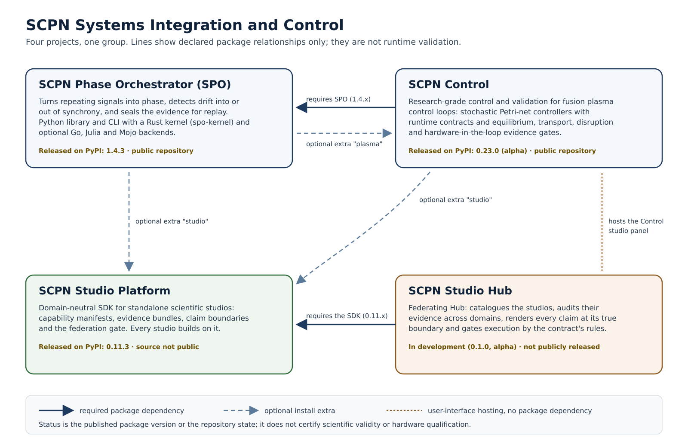

<!--
SPDX-License-Identifier: AGPL-3.0-or-later
Commercial license available
© Concepts 1996–2026 Miroslav Šotek. All rights reserved.
© Code 2020–2026 Miroslav Šotek. All rights reserved.
ORCID: 0009-0009-3560-0851
Contact: www.anulum.li | protoscience@anulum.li
SCPN Phase Orchestrator — group and project map
-->

# Group and project map

SCPN Phase Orchestrator belongs to **SCPN Systems Integration and Control**, a
group of four projects that work on one question from different sides: how do
coupled rhythms drift into or out of synchrony, how can a control loop act on
that, and how can every resulting number be shown with an honest, checkable
boundary?

- **SCPN Phase Orchestrator (SPO)** is the analysis engine. It turns repeating
  signals into phase, detects drift and seals the evidence.
- **SCPN Control** builds fusion plasma control loops on top of SPO and gates
  them with physics and hardware-in-the-loop evidence.
- **SCPN Studio Platform** is the shared SDK and evidence standard for
  scientific studios, including the studio panels that SPO and SCPN Control
  can provide.
- **SCPN Studio Hub** federates those studios, audits their evidence across
  domains and renders each claim at its true boundary.

The four projects keep their own repositories, histories, releases and
governance. This page describes what each one does and how they relate. It does
not describe a split, a merger or a migration.

[Open the full-size SVG](assets/scpn_siac_group_map.svg),
[download PNG](assets/scpn_siac_group_map.png), or
[download JPG](assets/scpn_siac_group_map.jpg) (2400 × 1560 pixels).

## What exists today

| Project | Function | Current status |
| --- | --- | --- |
| [SCPN Phase Orchestrator](https://github.com/anulum/scpn-phase-orchestrator) | Python library and CLI that maps waveforms, event streams and state changes to phase, measures synchronisation and seals the results as replayable evidence with false-alarm-controlled claim boundaries. Rust kernel (`spo-kernel`) with optional Go, Julia and Mojo backends. | Released on [PyPI](https://pypi.org/project/scpn-phase-orchestrator/) (1.4.3). Public repository. Each capability carries its own evidence status; see the README's [evidence status](https://github.com/anulum/scpn-phase-orchestrator#evidence-status-what-is-externally-validated-and-what-is-not). |
| [SCPN Control](https://github.com/anulum/scpn-control) | Research-grade control and validation for fusion plasma control loops: stochastic Petri-net controllers with runtime contracts, connected to equilibrium, transport, disruption, digital-twin and hardware-in-the-loop evidence gates. | Released on [PyPI](https://pypi.org/project/scpn-control/) (0.23.0, alpha). Public repository. Not a facility-qualified control system. |
| SCPN Studio Platform | Domain-neutral SDK for standalone scientific studios: capability manifests, evidence bundles, claim boundaries, verification paths and the federation gate. | Released on [PyPI](https://pypi.org/project/scpn-studio-platform/) (0.11.3). The source repository is not public. |
| SCPN Studio Hub | Federating Hub for the studios: catalogue, cross-studio evidence audit, honesty-preserving rendering and execution gating, with a web shell that hosts studio panels. | In development (0.1.0, alpha). Not publicly released. |

A place in this table does not imply a qualified runtime, hardware support or
scientific validation beyond what each project documents for itself.

## How the projects relate

The arrows in the map show **declared package relationships** read from each
project's packaging metadata. They are not runtime validation, data flow
guarantees or a build order.

| From | To | Kind | What it means |
| --- | --- | --- | --- |
| SCPN Control | SCPN Phase Orchestrator | Required dependency (`>=1.4.3,<1.5`) | Every SCPN Control install includes SPO. |
| SCPN Phase Orchestrator | SCPN Control | Optional extra `plasma` | Installs SCPN Control next to SPO for plasma work; plain SPO does not need it. |
| SCPN Phase Orchestrator | SCPN Studio Platform | Optional extra `studio` | Installs the studio SDK for SPO's studio integration (Python 3.12 or newer). |
| SCPN Control | SCPN Studio Platform | Optional extra `studio` | Installs the studio SDK for the Control studio vertical. |
| SCPN Studio Hub | SCPN Studio Platform | Required dependency (`>=0.11.3,<0.12`) | The Hub core is built on the SDK contract. |
| SCPN Studio Hub | SCPN Control | User-interface hosting | The Hub's web shell builds and hosts the Control studio panel. This is not a package dependency. |

## Where to start

- To analyse synchronisation in your own signals, start with SPO's
  [installation](getting-started/installation.md) and
  [quickstart](getting-started/quickstart.md).
- To study fusion control loops, start with the
  [SCPN Control README](https://github.com/anulum/scpn-control#readme).
- To build a studio that reports evidence in the shared standard, install
  [`scpn-studio-platform`](https://pypi.org/project/scpn-studio-platform/) and
  follow its package documentation.

## Boundaries

Each project states its own maturity, licensing and evidence. This page repeats
only published package versions and repository visibility; it adds no release
dates, certifications or claims.
